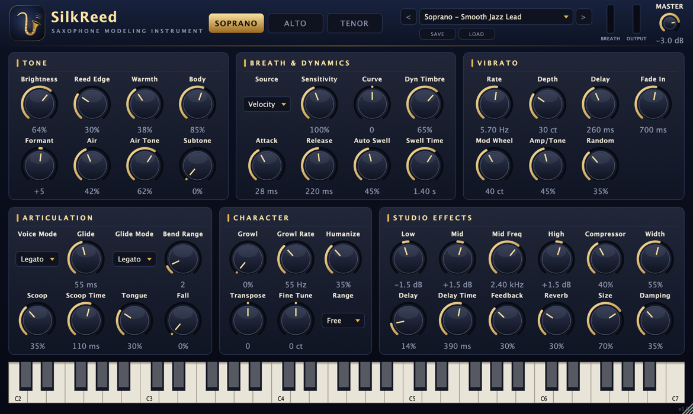

# SilkReed Sax — 색소폰 모델링 가상악기 (VST3 / AU / Standalone, macOS)



소프라노·알토·테너 색소폰을 실시간으로 합성하는 전문가용 가상악기입니다.
샘플을 쓰지 않고 연주 표현(브레스, 비브라토, 레가토, 스쿱, 그로울)을 모델링하기 때문에
EWI·브레스 컨트롤러와 건반 모두에서 자연스럽게 연주됩니다.
스무드 재즈 소프라노 톤(밝고 달콤하며 숨결이 섞인 소리, 느리게 들어오는 비브라토, 매끄러운 레가토)을
기본 프리셋 **"Soprano - Smooth Jazz Lead"**로 제공합니다.

## 빌드 & 설치

Apple Silicon 전용, Intel 전용, 유니버설(둘 다 한 파일에) 중에서 고릅니다.

```sh
./build.sh             # 지금 이 Mac의 CPU
./build.sh arm64       # Apple Silicon 전용        → build-arm64/
./build.sh x86_64      # Intel 전용 (별칭: intel)   → build-x86_64/
./build.sh universal   # 유니버설 (arm64 + x86_64)  → build-universal/
```

| 대상 | 실행되는 Mac |
|---|---|
| `arm64` | Apple Silicon Mac |
| `x86_64` | Intel Mac. Apple Silicon Mac에서는 Rosetta로 실행한 DAW에서만 로드됩니다 |
| `universal` | Apple Silicon Mac과 Intel Mac 모두. 파일 크기가 약 두 배입니다 |

- 결과물은 `build-<대상>/SilkReedSax_artefacts/Release/{VST3,AU,Standalone}`에 생깁니다.
- 빌드가 끝나면 `Tools/check_arch.sh`가 바이너리의 CPU를 검사하고, `Tools/post_build.sh`가 모든 번들을 ad-hoc 서명합니다.
- 플러그인은 **이 Mac에서 실행할 수 있을 때만**(이 Mac의 CPU용이거나 유니버설일 때) `~/Library/Audio/Plug-Ins/VST3`와 `~/Library/Audio/Plug-Ins/Components`에 자동 설치됩니다. Apple Silicon Mac에서 Intel용으로 빌드하면 설치하지 않으므로, 이미 설치된 플러그인이 덮이지 않습니다. 이 결과물은 Intel Mac으로 복사해서 쓰세요. 자동 설치를 끄려면 `-DSILKREED_INSTALL_PLUGINS=OFF`를 붙입니다.
- 설치되는 것은 이 Mac에서 실행 가능한 빌드 중 **마지막에 빌드한 것**입니다(명령줄과 Xcode 모두).
- CMake를 직접 쓸 때는 `-DSILKREED_ARCH=arm64|x86_64|universal|native`를 지정합니다.
- 필요 도구: Xcode(커맨드라인 툴), CMake ≥ 3.22. JUCE 8.0.9는 `ThirdParty/JUCE`에 있으며, 없으면 `setup.sh`가 내려받습니다.

## Xcode에서 개발하기

```sh
./xcode.sh            # build-xcode/SilkReedSax.xcodeproj 생성 후 Xcode로 열기
```

Xcode 프로젝트는 하나이고, **빌드 구성(Configuration)으로 CPU를 고릅니다.**

| 빌드 구성 | CPU | 결과물 위치 (`build-xcode/SilkReedSax_artefacts/…`) |
|---|---|---|
| `Debug_AppleSilicon` | Apple Silicon (arm64) | `Debug_AppleSilicon/` |
| `Release_AppleSilicon` | Apple Silicon (arm64) | `Release_AppleSilicon/` |
| `Debug_Intel` | Intel (x86_64) | `Debug_Intel/` |
| `Release_Intel` | Intel (x86_64) | `Release_Intel/` |
| `Debug_Universal` | Apple Silicon + Intel | `Debug_Universal/` |
| `Release_Universal` | Apple Silicon + Intel | `Release_Universal/` |

**구성을 바꾸는 방법:** 툴바의 스킴 이름을 클릭 → **Edit Scheme…**(⌘<) → 왼쪽에서 **Run** → **Info** 탭 → **Build Configuration**에서 고릅니다. ⌘B(빌드)와 ⌘R(실행)은 이 구성으로 동작합니다. Archive는 같은 창의 **Archive** 항목에서 따로 고릅니다.

- 구성마다 결과물 폴더가 따로라서 서로 덮어쓰지 않습니다.
- Apple Silicon Mac에서 `Debug_Intel` 구성으로 Standalone을 ⌘R 실행하면 Rosetta로 실행되어 Intel 동작을 확인할 수 있습니다.
- `*_Intel` 구성으로 빌드한 플러그인은 Apple Silicon Mac에 설치되지 않습니다. `*_Universal`과 이 Mac의 CPU 구성은 설치됩니다(위 설치 규칙과 같음).
- 배포용 유니버설 빌드에는 `Release_Universal`을 쓰세요. 두 CPU를 모두 컴파일하므로 빌드 시간이 약 두 배입니다.
- 명령줄에서는 `xcodebuild -project build-xcode/SilkReedSax.xcodeproj -scheme SilkReedSax_All -configuration Release_Intel build`처럼 씁니다.

Xcode 툴바의 스킴 메뉴에서 빌드할 대상을 고릅니다.

| 스킴 | 용도 |
|---|---|
| `SilkReedSax_Standalone` | 단독 실행 앱. ⌘R로 바로 실행하고 브레이크포인트로 디버깅하기에 가장 편합니다 |
| `SilkReedSax_AU` / `SilkReedSax_VST3` | 플러그인 빌드(이 Mac의 CPU용이면 자동 설치). ⌘R을 누르면 호스트(Logic Pro 등, 자동 감지)를 띄워 플러그인을 디버깅합니다 |
| `SilkReedSax_All` | VST3 + AU + Standalone 한 번에 빌드 |
| `SilkReedTool` | 개발 도구. ⌘R 기본 인수는 `render build-xcode/renders` |

- 소스는 내비게이터의 `SilkReedSax → Source` 그룹에 있습니다. 파일을 새로 추가할 때는 Xcode에서 직접 추가하지 말고 `CMakeLists.txt`의 `SILKREED_CORE_SOURCES` / `SILKREED_HEADERS`에 적으세요. 다음 빌드 때 프로젝트가 자동으로 다시 생성됩니다(`ZERO_CHECK`).
- 디버깅용 호스트를 바꾸려면 `cmake -B build-xcode -G Xcode -DSILKREED_DEBUG_HOST="/Applications/REAPER.app"`처럼 지정합니다.
- Logic에서 디버깅할 때 Logic이 서명된 호스트라 디버거 연결이 막히면, Standalone 스킴으로 디버깅하거나 REAPER처럼 디버깅을 허용하는 호스트를 쓰세요.
- DAW에서 플러그인을 다시 스캔하세요. Logic Pro에서는 Instrument → AU Instruments → SilkReed Audio → SilkReed Sax 경로에 있습니다.

## 사운드 엔진

| 구성 요소 | 내용 |
|---|---|
| 하모닉 엔진 | 위상 고정형 배음 오실레이터 64개. 브레스 세기에 따라 스펙트럼 기울기와 컷오프가 바뀌어, 세게 불수록 밝아지는 색소폰 특유의 다이내믹 음색을 냅니다 |
| 바디 포먼트 | 악기별 보어/벨 공명과 톤홀 격자 피크 (소프라노/알토/테너가 각각 다른 프로파일) |
| 브레스 노이즈 | 피치에 동기된 숨결 노이즈 + 자유로운 에어 히스, 포먼트로 착색 |
| 리드 | 다이내믹에 반응하는 리드 새츄레이션 (Reed Edge) |
| 표현 | 딜레이/페이드인 비브라토(피치 + 음량/음색 립 비브라토), 스쿱, 폴, 텅잉 트랜지언트, 레가토 슬러, 그로울, 휴머나이즈 |
| 이펙트 | 3밴드 EQ, RMS 컴프레서, 스테레오 초기 반사(Width), 핑퐁 딜레이, 8라인 FDN 리버브, 안전 리미터 |

CPU 사용량(Apple Silicon 기준): 모노 약 0.7%, 8보이스 폴리 약 3.8% (코어 1개 기준).

## 컨트롤러 (EWI / 브레스 컨트롤러)

| MIDI | 기능 |
|---|---|
| CC2 (Breath) | Source = *Breath CC2*일 때 음량과 음색을 실시간으로 제어 (EWI 프리셋에 기본 설정) |
| CC11 (Expression) | Source = *Expr CC11* 또는 *Vel x CC11* |
| Aftertouch | Source = *Aftertouch* |
| CC1 (Mod Wheel) | 비브라토 추가 (Mod Wheel 노브로 깊이 조절) |
| Pitch Bend | Bend Range 1–12반음 |
| CC64 | 서스테인 |

**Curve**와 **Sensitivity**로 브레스 반응 곡선을 연주자에게 맞추세요. 헤더의 BREATH 미터에서 입력값을 바로 확인할 수 있습니다.

## 프리셋

팩토리 프리셋 14개를 제공합니다 (소프라노 5, 알토 4, 테너 4, Init).
SAVE 버튼을 누르면 `~/Music/SilkReed Sax/Presets/*.srpreset`에 사용자 프리셋으로 저장됩니다.
노브를 더블클릭하면 기본값으로 돌아가고, 창 크기는 모서리를 끌어 60–200% 범위에서 조절할 수 있습니다.

## 개발 도구

```sh
build/SilkReedTool_artefacts/Release/SilkReedTool render out/    # 모든 프리셋의 데모 프레이즈 WAV 생성 + 레벨 통계
build/SilkReedTool_artefacts/Release/SilkReedTool bench          # CPU 벤치마크
build/SilkReedTool_artefacts/Release/SilkReedTool snapshot ui.png
build/SilkReedTool_artefacts/Release/SilkReedTool icon out/      # Icon.svg → PNG/iconset
python3 Tools/make_icon_svg.py                                   # 아이콘 SVG 재생성
```

## 저작권 · 라이선스 (Licensing)

**SilkReed Sax 자체 코드·리소스:** Copyright (c) 2026 SilkReed Audio. All rights reserved.
아이콘, 사운드 엔진, 팩토리 프리셋, 데모 프레이즈는 모두 이 프로젝트에서 새로 만든 것입니다. 샘플이나 녹음은 쓰지 않습니다.

SilkReed Sax는 독자적으로 만든 제품이며, 특정 아티스트나 다른 플러그인 제품과 제휴하거나 그들의 승인을 받지 않았습니다.
제품명, 프리셋 이름, UI, 문서에는 실존 아티스트의 이름이나 다른 제품의 이름·로고를 쓰지 않습니다. 홍보할 때도 같은 원칙을 지키세요.

### 서드파티 구성요소

전체 고지문은 [THIRD_PARTY_NOTICES.txt](THIRD_PARTY_NOTICES.txt)에 있습니다. 이 파일은 각 번들의 `Contents/Resources` 안에도 들어가고, 플러그인 화면의 **ABOUT** 버튼으로도 볼 수 있습니다.
JUCE를 업데이트하면 `python3 Tools/make_notices.py`로 다시 생성하세요.

| 구성요소 | 포함 위치 | 라이선스 |
|---|---|---|
| JUCE 8 | 전체 | **AGPLv3 또는 상용 JUCE 라이선스** (택일) |
| Steinberg VST3 SDK | VST3 | **Steinberg VST3 라이선스 또는 GPLv3** (택일) |
| Apple AudioUnitSDK | AU | Apache 2.0 |
| zlib, libpng | 전체 | zlib |
| IJG JPEG 라이브러리 | 전체 | IJG ("based in part on the work of the Independent JPEG Group" 문구 표기) |
| HarfBuzz | 전체 | Old MIT |
| SheenBidi | 전체 | Apache 2.0 |

FLAC, Ogg Vorbis 코덱은 쓰지 않으므로 빌드에서 뺐습니다(`JUCE_USE_FLAC=0`, `JUCE_USE_OGGVORBIS=0`).

### 배포 전에 결정해야 할 것

개인적으로 쓰는 데는 추가 의무가 없습니다. **다른 사람에게 배포(무료 포함)하거나 판매할 때는** 아래 둘 중 하나를 골라야 합니다.

1. **오픈소스로 배포:** 이 프로젝트 전체를 AGPLv3로 공개합니다. 소스 코드 전체를 함께 제공해야 하며, VST3 SDK는 GPLv3 조건으로 사용합니다(AGPLv3와 함께 쓸 수 있음). 이 경우 소스 파일 상단의 "All rights reserved." 문구를 AGPLv3 표기로 바꾸고 `LICENSE` 파일을 추가하세요.
2. **비공개(상용)로 배포:** 다음 두 가지를 모두 갖춰야 합니다.
   - JUCE 상용 라이선스 (등급과 조건은 https://juce.com/get-juce 참고)
   - VST3 플러그인을 배포한다면 Steinberg와 VST3 라이선스 계약 (https://www.steinberg.net/developers)

그 밖의 권장 사항:
- **상표:** "VST"는 Steinberg Media Technologies GmbH의 등록상표이고, "Audio Units"는 Apple Inc.의 상표입니다. VST 로고를 쓰려면 Steinberg의 사용 지침을 따라야 합니다.
- **제품명:** "SilkReed"라는 이름과 AU 제조사 코드(`Slkr`)는 상업적으로 출시하기 전에 상표 검색으로 충돌 여부를 확인하세요.
- **배포 서명:** 다른 Mac에 배포하려면 Apple Developer ID 서명과 공증(notarization)이 필요합니다.

> 이 안내는 법률 자문이 아닙니다. 상용으로 출시하기 전에는 각 라이선스 원문을 직접 확인하고, 필요하면 전문가와 상의하세요.
